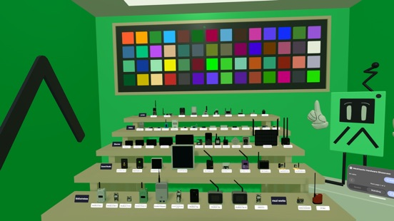

# 3d-assets

Tools that build Meshtastic's 3D assets, shared by the Apple and Android apps.

*The device models in the Hardware Showcase on Apple Vision Pro.*

- `models/`: real-size models of Meshtastic devices, built from the device illustrations on the [web flasher](https://github.com/meshtastic/web-flasher) and each device's published dimensions. Each model is built as USDZ for Apple platforms and GLB for Android, desktop and the web. See [models/README.md](models/README.md).

The models are published to the web flasher, which serves them at `https://flasher.meshtastic.org/models/devices/<name>.usdz` and `<name>.glb`. The apps get them from there.

## License

The code here is licensed under the GNU GPLv3 (see [LICENSE](LICENSE)). The device models it builds are not: see [models/LICENSE-models.md](models/LICENSE-models.md).
